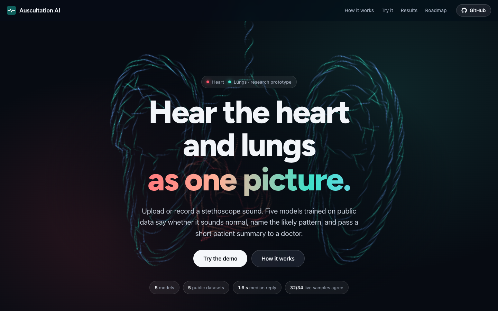
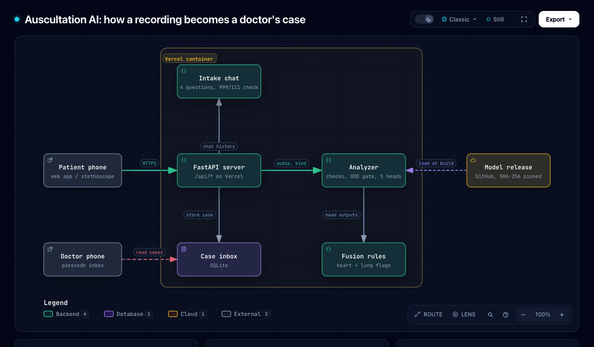
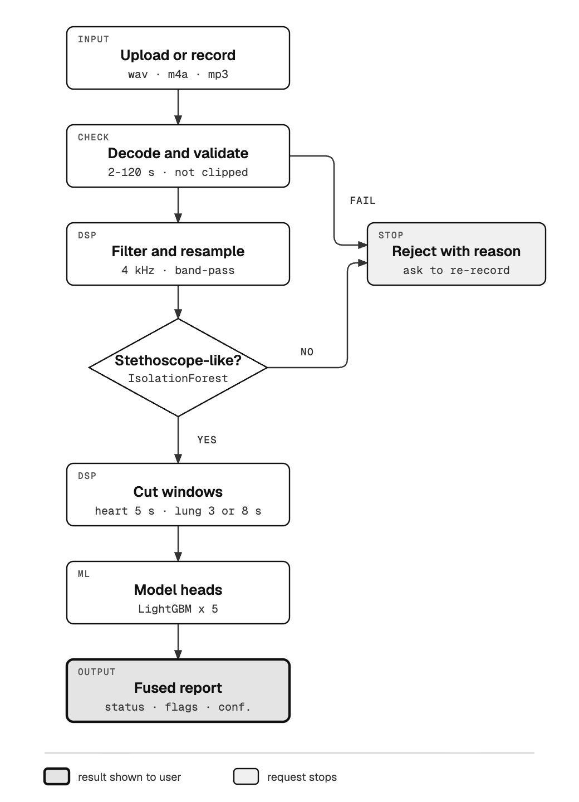
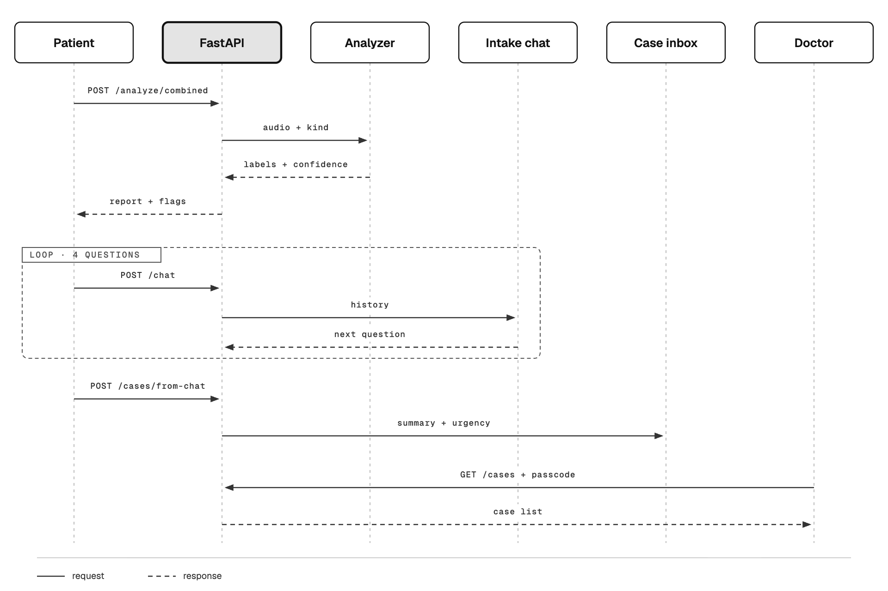
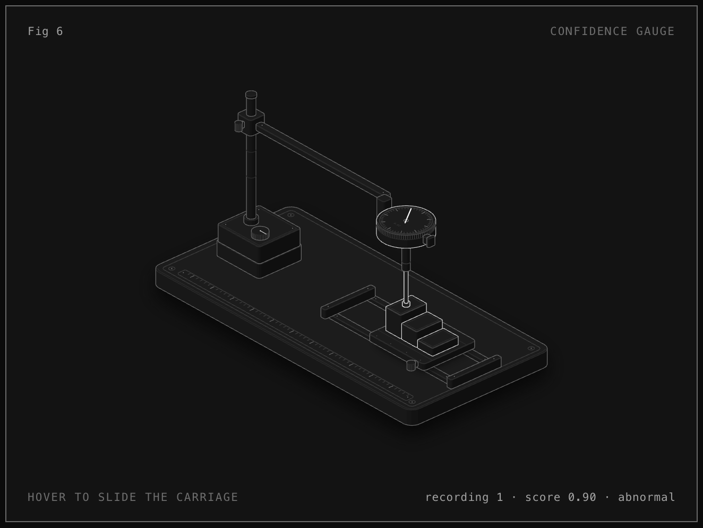
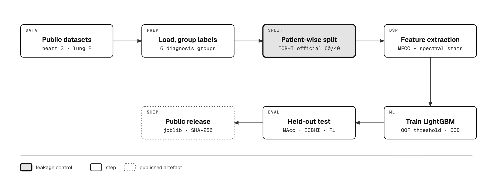
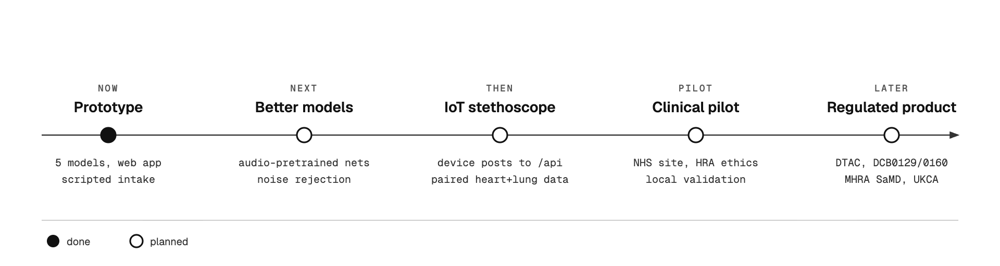

<div align="center">

# Auscultation AI

**Hear the heart and lungs as one picture.**

AI analysis of heart and lung stethoscope sounds, a patient intake chat, and a doctor inbox, built only on public data and free infrastructure.

[**Live demo**](https://auscultation-ai.vercel.app) · [IEEE report (PDF)](docs/report/report.pdf) · [How it works](#how-it-works) · [Results](#results) · [Run it locally](#run-it-locally) · [Roadmap](#roadmap)

[](https://colab.research.google.com/github/adityavdn/auscultation-ai/blob/main/notebooks/reproduce_results.ipynb)




</div>

> [!WARNING]
> Research prototype. Decision support only. **Not a medical device.** It has not been validated on patients and must not be used for real clinical decisions.

## What it does

You give it a stethoscope recording of the heart, the lungs, or both. It checks the recording is usable, runs five classifiers, and returns one report: normal, abnormal or inconclusive, a line per model with its confidence, and flags that combine the two organs (a murmur together with crackles, for example, suggests checking for heart failure). A short chat then asks the patient four questions, catches emergency phrases and points them to 999 or 111, and sends a structured summary to a passcode-protected doctor inbox.

The app is a phone-friendly web page on top of a REST API. A future IoT stethoscope can post audio to the same endpoints without any change to the server.

## How it works



The live, explorable version of this diagram is at [auscultation-ai.vercel.app/figures/architecture.html](https://auscultation-ai.vercel.app/figures/architecture.html).

<table>
<tr>
<td width="50%"></td>
<td width="50%">

**One recording, step by step**

1. Decode the audio (ffmpeg handles phone formats), convert to mono 4 kHz and keep the first 120 s.
2. Reject it with a clear reason if it is shorter than 2 s, nearly silent, invalid or clipped.
3. Band-pass it: 25 to 400 Hz for the heart, 50 to 1,900 Hz for the lungs.
4. An IsolationForest decides whether it sounds like a stethoscope at all. Tones and speech are turned away.
5. Cut it into windows, score each with LightGBM on MFCC and spectral features, and average per recording.
6. Merge heart and lung results with transparent rules. Abnormal needs a score of 0.60 or more.

</td>
</tr>
</table>





<sub>The confidence gauge on the site is interactive: slide between recordings and the needle reads each score against the 0.60 threshold. Scores in the figure are illustrative.</sub>

## Results

Every test set is held out **by patient** wherever the dataset publishes patient IDs (CirCor, ICBHI, KAUH). CinC 2016 and Yaseen publish none, so they are split by recording and may read optimistic.

| Task | Data | Metric | Score | Published reference |
|---|---|---|---|---|
| Heart normal / abnormal | PhysioNet/CinC 2016, adults | MAcc | **0.882** | ~0.86 on the hidden challenge set |
| Heart murmur | CirCor DigiScope 2022, children | MAcc | **0.724** | different metric in the challenge |
| Heart valve class (N, AS, MS, MR, MVP) | Yaseen 2018 | Accuracy | 1.000 | ~0.97; small, clean dataset |
| Lung sounds, 4 classes | ICBHI 2017 official split | ICBHI score | **0.507** | ~0.60 to 0.65 state of the art |
| Lung diagnosis, 6 groups | ICBHI 2017 + KAUH 2021 | Macro-F1 | **0.433** | no single benchmark |

Live check: 32 of 34 held-out samples served by the deployed app matched their dataset label, with a median reply of 1.6 s.

The lung sound model is the weak spot. An ImageNet EfficientNet-B0 scored 0.510 and a 50/50 ensemble 0.511. AudioSet AST embeddings reached 0.533 (full model) and 0.519 (a slim int8 version that runs in about 70 ms a window). A patient-level bootstrap shows these gains are within noise for a 49-patient test set, so the live app keeps LightGBM; the slim model is an optional release asset. Full numbers and confusion matrices are in [`reports/results.md`](reports/results.md).



## Data

All training data is public. Please cite the original authors.

| Dataset | Organ | Size | Licence |
|---|---|---|---|
| [PhysioNet/CinC Challenge 2016](https://physionet.org/content/challenge-2016/) (Liu et al., 2016) | Heart | 3,240 recordings | ODC-BY 1.0 |
| [CirCor DigiScope 2022](https://physionet.org/content/circor-heart-sound/) (Oliveira et al., 2022) | Heart | 5,272 recordings, 1,568 children | ODC-BY 1.0 |
| Yaseen, Son & Kwon (2018), *Appl. Sci.* 8(12):2344 | Heart | 1,000 clips, 5 classes | see the paper |
| ICBHI 2017 Respiratory Sound Database (Rocha et al., 2019) | Lung | 920 recordings, 126 patients | see the database |
| Fraiwan et al. (2021), *Data in Brief* (KAUH) | Lung | 336 recordings, 112 subjects | CC BY 4.0 |

Trained models, held-out samples and metrics are published as a release asset of this repository ([`v5`](https://github.com/adityavdn/auscultation-ai/releases/tag/v5)). The container downloads it at build time and checks its SHA-256, because joblib files are pickles.

## Run it locally

```bash
git clone https://github.com/adityavdn/auscultation-ai.git
cd auscultation-ai
python3.13 -m venv venv && source venv/bin/activate
pip install -r requirements.txt
curl -fsSL -o assets.tgz https://github.com/adityavdn/auscultation-ai/releases/download/v5/auscultation-assets.tgz
mkdir -p local && tar xzf assets.tgz -C local
MODELS_DIR=local/models SAMPLES_DIR=local/samples DOCTOR_PASSCODE=change-me \
  uvicorn app.main:app_from_env --factory --port 7860
```

Open http://localhost:7860. Interactive API docs are at `/docs`. Or build the same container that runs in production:

```bash
docker build -t auscultation-ai . && docker run -p 7860:7860 -e DOCTOR_PASSCODE=change-me auscultation-ai
```

To reproduce the headline results without installing anything, open [`notebooks/reproduce_results.ipynb`](notebooks/reproduce_results.ipynb) in Google Colab (badge above): it downloads the published models and re-runs the 34-sample check.

Run the tests with `pytest`. The torch tests for the CNN experiment are skipped unless `RUN_TORCH_TESTS=1`.

### API

| Endpoint | Purpose |
|---|---|
| `POST /api/analyze/{heart\|lung}` | analyse one recording |
| `POST /api/analyze/combined` | heart and lung together, fused report |
| `GET /api/samples` | held-out dataset samples |
| `POST /api/chat` | next intake message |
| `POST /api/cases/from-chat` | send the intake summary to the inbox |
| `GET /api/cases` | doctor inbox (header `x-doctor-passcode`) |
| `GET /api/health` | liveness and loaded models |

### Retrain the models

```bash
pip install -r requirements-ml.txt
python -m ml.run_all <data_dir> <out_dir>          # downloads the datasets, trains all five heads
python -m ml.run_lung_cnn prep <data_dir> <out_dir> # optional CNN experiment, stage 1
python -m ml.run_lung_cnn train <out_dir> 12 cpu    # stage 2
```

## Project layout

```text
app/            FastAPI server, analyzer, fusion rules, intake agent, SQLite inbox
app/static/     phone web app: 3D heart and lungs background, GSAP + Lenis motion, figures
ml/             audio checks, features, dataset loaders, training, OOD gate, CNN experiment
docs/figures/   report diagrams (build.py renders them)
docs/report/    IEEE-format report: LaTeX source and PDF
notebooks/      Colab notebook that reproduces the results from the published models
reports/        held-out results
Dockerfile      production image, pulls the pinned model release
```

## Roadmap



- **Better models.** Audio-pretrained networks (AudioSet AST, PANNs, OPERA, HeAR) on a GPU for the lung task, and a stethoscope-versus-noise detector so white noise is rejected too.
- **IoT stethoscope.** A device posts to the existing API. Recording heart and lungs from the same people allows a joint model to learn what the rules now approximate.
- **NHS pilot.** HRA ethics approval, a data protection impact assessment, UK hosting, individual clinician accounts and audit logs, validated against clinician auscultation.
- **Regulated product.** DCB0129 and DCB0160 clinical safety, DTAC, the NICE evidence standards and MHRA software as a medical device (UKCA).

## Safety notes

The models learned from research datasets recorded on particular stethoscopes and populations. Accuracy will not carry over unchanged to new devices or NHS patients. Heart and lung models were never trained on the same people, so the combined flags are clinical heuristics. Cases live in SQLite inside a stateless container and vanish on restart, and the inbox uses one shared passcode. All of that is fine for a demonstration and not acceptable for patient data.

## Author

Built by **Aditya Vardhan**, University of Roehampton.
